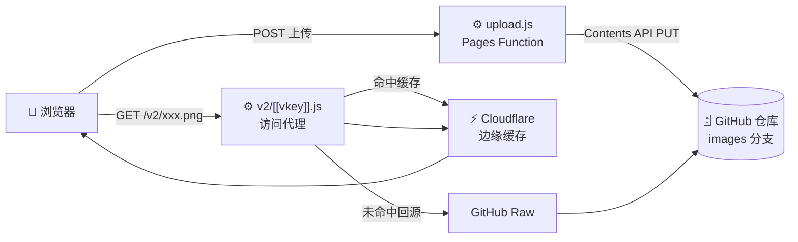
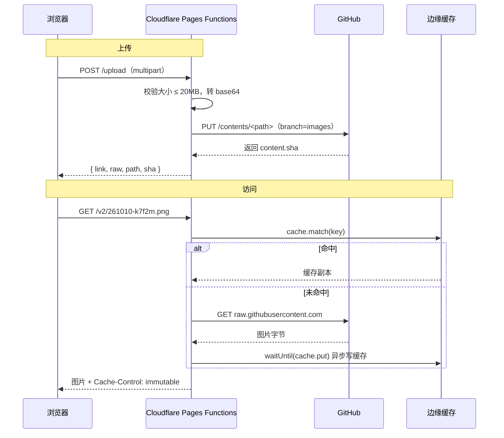
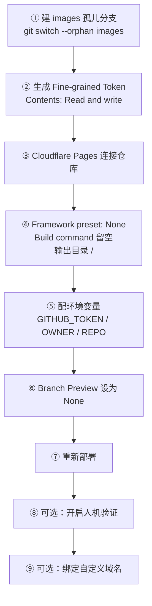
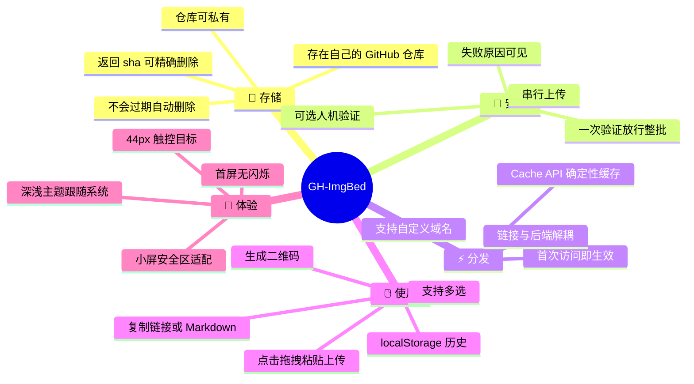
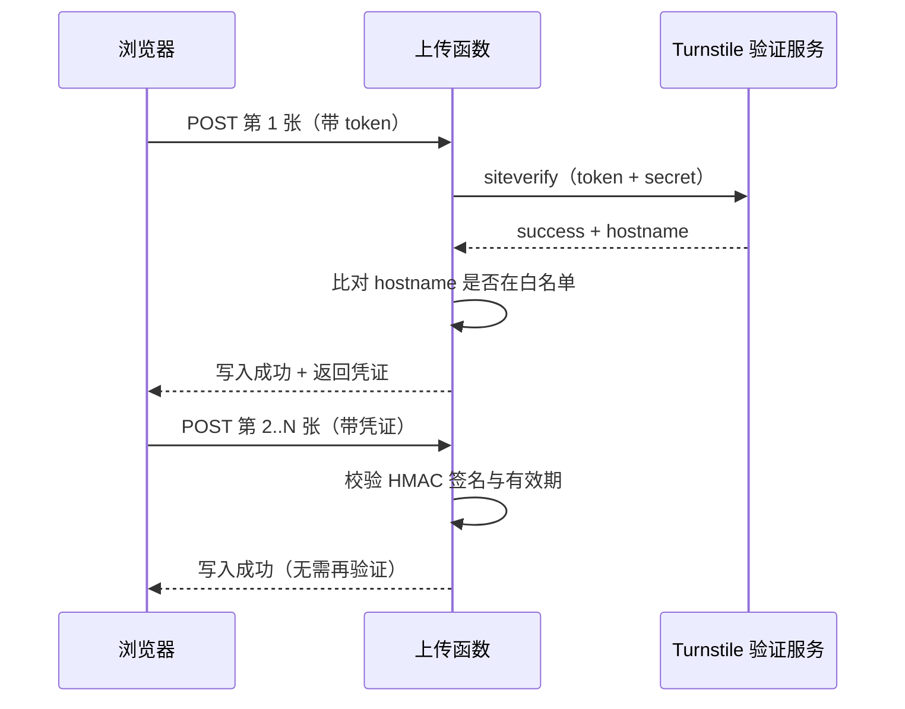

一个零服务器成本的免费图床：**图片存进你自己的 GitHub 仓库**，通过 Cloudflare 边缘节点缓存分发。

前端是纯静态页面，后端只有两个 Cloudflare Pages Functions。没有数据库、没有自建服务器、没有构建步骤。

:::tip[为什么不用现成图床]
第三方图床要么有「X 个月未访问自动删除」，要么哪天就关停了。图片存在自己仓库里，数据在自己手上，链接也不会因为服务跑路而失效。
:::

---

## 🏗️ 整体架构

浏览器从头到尾只跟 Cloudflare 边缘节点通信，回源由服务端完成。



**关键点**：访客所在网络能否直连 GitHub，并不影响访问 —— 回源这一步发生在服务端。

---

## 🔄 上传与访问时序



文件名格式是 `YYMMDD-5位随机.扩展名`，例如 `261010-k7f2m.png`。5 位随机空间约 6000 万，撞名概率极低，代码里仍保留了最多 6 次的换名重试。

---

## 🚀 部署流程



---

## ✨ 功能特性



---

## ⚙️ 环境变量

| 变量名 | 说明 | 必填 |
| :-- | :-- | :--: |
| `GITHUB_TOKEN` | Fine-grained 令牌，仅对存图仓库开放 Contents 读写 | ✅ |
| `GITHUB_OWNER` | 存图仓库的所有者用户名 | ✅ |
| `GITHUB_REPO` | 存图仓库名 | ✅ |
| `GITHUB_PATH` | 仓库内子目录，留空则存根目录（链接更短） | 可选 |
| `IMG_CDN` | 设为 `jsdelivr` 可改走 jsDelivr 回源 | 可选 |
| `TURNSTILE_SECRET` | Turnstile 的 **Secret Key**（不是 Site Key） | 可选 |
| `TURNSTILE_HOSTNAMES` | 实际访问用的完整主机名，逗号分隔 | 启用验证时必填 |

:::caution[两个容易踩的坑]
**1. 分支名固定为 `images`，不能自定义。**

访问代理不校验路径，如果图片与代码同分支，代码文件可能被构造路径读到。固定孤儿分支是安全隔离的前提。

**2. 务必把 Branch Preview 设为 None。**

否则每次上传图片推送到 `images` 分支都会触发一次构建，很快耗尽每月 500 次的免费额度。

改完环境变量需要**重新部署**才生效。
:::

---

## 🔐 人机验证（可选）

防止脚本批量刷上传接口，基于 Cloudflare Turnstile。**只保护上传，不保护 `/v2/`** —— 那是出图用的，加了验证图就无法外链了。

### 为什么需要两处配置

| 配置 | 位置 | 作用 |
| :-- | :-- | :-- |
| widget 的 domains | Turnstile 控制台 | 哪些域名**能签发** token |
| `TURNSTILE_HOSTNAMES` | 环境变量 | 只接受**为你签发**的 token |

两处都要配。只配控制台是不够的：任何人都能自己建一个 widget（域名填他自己的），通过挑战后把 token 提交给你的接口，Cloudflare 会如实回答 `success=true` —— 那确实是真的 token，只是不是为你签发的。所以后端必须比对 `hostname`。

### 一次验证放行整批

Turnstile token 是**一次性**的，无法在多张图之间复用。所以由后端签发凭证解决：

```text
第 1 张    ──带 token──> siteverify ──通过──> 签发 HMAC 凭证（10 分钟）
第 2..N 张 ──带凭证──> 校验签名与有效期 ──通过──> 写入 GitHub
```

凭证是用 `TURNSTILE_SECRET` 做的 HMAC-SHA256 签名，无法伪造 —— 攻击者仍须先通过一次真实验证才能拿到。批次结束后前端重置组件，下次批量需重新验证一次。



未配置 `TURNSTILE_SECRET` 时行为不变（完全放行），可以随时启用或停用 —— 万一验证出问题，删掉这个变量就能立刻恢复。

:::caution[Secret Key 和 Site Key 长得几乎一样]
两串都以 `0x4AAAAAAA` 开头，光看开头分辨不出来，是本项目最容易填错的地方。Site Key 已写在 `index.html` 里（公开无妨），Secret Key 只能进环境变量。填错会报 `invalid-input-secret`，若已混淆，直接在控制台重新生成一个最省事。
:::

### 上传报「人机验证未通过」怎么排查

错误提示里会带上具体原因，对照这张表定位：

| 提示 | 原因 | 处理 |
| :-- | :-- | :-- |
| `invalid-input-secret` | Secret Key 填错，或误填成了 Site Key | 重新复制该 widget 的 Secret Key |
| 主机名不匹配：本站接受 X，实际为 Y | 访问域名与 `TURNSTILE_HOSTNAMES` 不一致 | 按提示里的 Y 填进去 |
| `timeout-or-duplicate` | token 已被用过，或超过 300 秒 | 刷新页面重新验证 |
| `invalid-input-response` | token 无效或已过期 | 同上 |
| `missing-input-response` | 前端没把 token 传上来 | 检查 widget 是否渲染成功 |
| 验证组件未加载 / 请求失败 | `challenges.cloudflare.com` 脚本没加载成功 | 检查网络能否访问该域名 |

实际踩过的坑，按概率排序：

1. **Secret Key 误填成 Site Key** —— 两者长得几乎一样，最容易犯。
2. `TURNSTILE_HOSTNAMES` 填了根域名（`5al.top`）而实际访问是子域名（`img.5al.top`）。
3. 改完环境变量**没有重新部署**，函数里读到的还是旧值。
4. 控制台 widget 的 domains 里没加实际访问用的域名。

---

## 📁 目录结构

```text
index.html                  页面结构
assets/app.css              样式：设计令牌、深浅主题、响应式
assets/app.js               逻辑：上传、列表、复制、二维码、主题
assets/fonts.css            Material Icons 字体声明（本地）
assets/fonts/*.woff2        Material Icons 字体文件
functions/upload.js         上传：写入 GitHub
functions/v2/[[vkey]].js   访问：回源 + 边缘缓存
scripts/verify_upload.py    部署前自检脚本
```

图标字体是本地自托管的，**不引用 fonts.googleapis.com**（该域名在中国大陆不可访问）。字体名须与 mdui 期望的完全一致，且需开启 `font-feature-settings: 'liga'`，否则连字不生效、图标会显示为文字。

---

## ✅ 部署前自检

```bash
export GITHUB_TOKEN='github_pat_xxx'
export GITHUB_OWNER='你的用户名'
export GITHUB_REPO='你的仓库'
python3 scripts/verify_upload.py
```

脚本会依次检查令牌有效性、仓库可访问性、写入权限、链接可访问性，并自动清理测试文件。

---

## ⚠️ 已知限制

| 限制 | 说明 |
| :-- | :-- |
| 单文件 20MB | 代码中已做校验 |
| 访问路径未做白名单 | 依赖 `images` 孤儿分支隔离，不要往该分支放非图片文件 |
| GitHub API 限额 | 5000 次/小时，个人图床足够 |
| Cloudflare 免费额度 | 请求 10 万/天，构建 500 次/月 |
| 仓库体积 | 建议控制在 1GB 以内 |
| 国内访问 | Cloudflare 在中国大陆无边缘节点，访客可能被路由到境外。可设 `IMG_CDN=jsdelivr` 改走 jsDelivr 回源 |
| 外部依赖 | 启用人机验证后会加载 `challenges.cloudflare.com` 脚本（验证的必要条件）。其余资源全部本地 |

---

## 🛠️ 技术栈

| 部分 | 说明 |
| :-- | :-- |
| 页面 | 原生 HTML + JavaScript，无框架、无构建 |
| 组件 | [mdui 2](https://www.mdui.org/)（Web Components，CDN 引入） |
| 图标 | Material Icons 字体（本地自托管） |
| 二维码 | qrcode（CDN，按需动态加载） |
| 人机验证 | Cloudflare Turnstile（可选，仅保护上传接口） |
| 后端 | Cloudflare Pages Functions |

---

## 📄 许可

MIT License — 可自由使用、修改和分发

---

::github{repo="xingmihai/gh-imgbed"}
